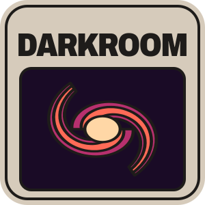

<p align="center">
  
</p>

<p align="center">
  A node-graph editor for image &amp; data pipelines — build a graph, wire it up, watch it run.
</p>

---

Darkroom lets you assemble a processing pipeline as a node graph and run it
live: wire nodes together and the graph **compiles → plans → executes** on a
background worker, streaming each node's status and results back onto the canvas
as it goes. It's a native desktop app built on [Palantir](https://github.com/xorza/palantir),
an immediate-mode GUI with a wgpu renderer, over a domain-agnostic graph engine.
Its first workload is imaging: general image processing and an astronomical
stacking pipeline.


## Run it

Clone with submodules (`git clone --recursive`, or `git submodule update --init`
after a plain clone): Palantir, fits-well and LibRaw build from them. LibRaw's
bindings need libclang — the Xcode tools on macOS, `winget install LLVM.LLVM` on
Windows, `libclang-dev` on Linux.

```sh
cargo run --profile release-dev                                  # the editor window
cargo run --profile release-dev -- darkroom/sample/sample.darkroom  # with the sample project
cargo run --profile release-dev -- --mcp --headless              # the editor as an MCP server, no window
```

`--mcp` alone serves the open window over stdio, so an agent can drive the
editor a person is looking at.

## Features

- **Node-graph canvas** — pan and zoom, rubber-band select, drag between ports
  to wire nodes, a node palette to spawn from, and a "breaker" scribble that
  severs wires and deletes nodes in one gesture. Wires gather into ribbons with
  ties; event subscriptions draw as wires of their own.
- **Live async execution** — the graph runs on a background tokio worker. Each
  node shows its status (running, cached, executed, errored, skipped), its
  elapsed time, and the RAM and VRAM its cached output holds.
- **Caching per node** — none, RAM, disk or both. The disk cache sits in a
  folder beside the project, so reproducible results reload across sessions
  instead of recomputing.
- **Panes in docked tabs** — the graph, an image viewer, an inspector with a
  node's live inputs and outputs, and preferences.
- **Undo** — every edit goes through one undo history, and a held gesture is
  one entry that Esc takes back whole. Pan and zoom are saved with the project
  but never undone.
- **Project files** — RON text in `.darkroom`, or the same text zipped in
  `.darkroomz`. Paths to files in the project's folder are stored relative to
  it, so the folder moves as one.
- **Imaging nodes** — image I/O and processing, camera RAW through LibRaw, FITS
  through fits-well, and the astronomical pipeline: calibration, star
  detection, registration, stacking, drizzle, and ONNX denoise and star removal.
- **An agent harness** — the MCP server opens projects, plays input, waits for
  runs, and reads the editor back as text or as a screenshot.

## Under the hood

Darkroom is a Cargo workspace:

| Crate | Role |
|-------|------|
| **darkroom-app** (`app/`) | The `darkroom` binary: the window, or with `--mcp` the editor served over stdio. *Default member.* |
| **[darkroom](darkroom)** | The editor's library: the document and its undo, the GUI, and the driver that plays input into it. |
| **scenarium** | The headless graph engine: the authoring model and compile → plan → execute on a tokio worker. |
| **lens** | The node libraries: application nodes, and adapters over `imaginarium` and `lumos`. |
| **lumos** | The astronomical pipeline: RAW/FITS decode, calibration, star detection, registration, stacking, drizzle. |
| **imaginarium** | Pixels in both layouts, interleaved and planar, with their codecs and ops, on the CPU and, behind a feature, the GPU. |
| **libraw** | A safe wrapper over LibRaw, the camera RAW decoder, built statically from its submodule. |
| **simd** | Every vector instruction of the workspace: the vector types, their ops, and the kernel dispatch. |
| **common** | The shared base: ids, serialization, cancellation, the 2D grid, and every I/O and thread call. |
| **[palantir](https://github.com/xorza/palantir)** | The immediate-mode GUI — WPF-style two-pass layout, wgpu renderer. *Submodule.* |
| **fits-well** | A reader and writer for FITS, astronomy's image format, aiming at the full FITS 4.0 standard. *Submodule.* |

`common` and `simd` are the leaves; `scenarium` builds the graph engine on
`common`; `darkroom` edits a `scenarium` graph, draws it through `palantir`, and
takes its nodes from `lens`, over `imaginarium`, `lumos` and `fits-well`.

## Develop

Every check runs through [cargo-drive](https://github.com/xorza/drive), from the
workspace root:

```sh
cargo install --locked --git https://github.com/xorza/drive
cargo drive check   # format and lints
cargo drive test    # the tests
cargo drive gate    # everything CI runs
```

`AGENTS.md` and each crate's own hold the project's decisions.
